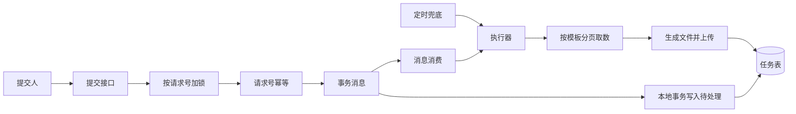
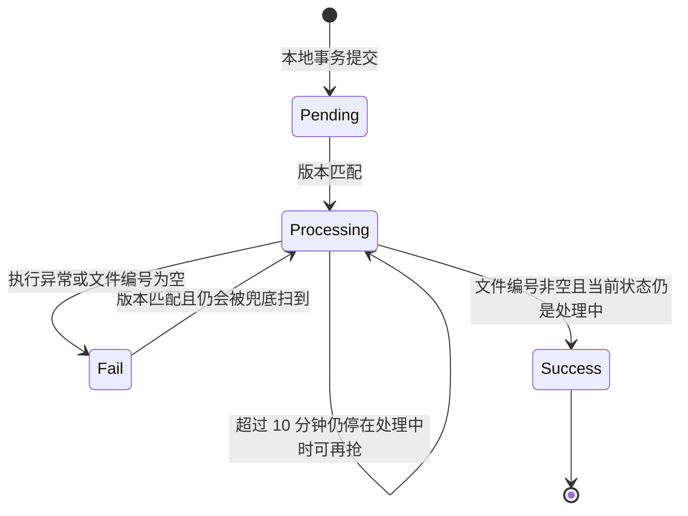

# 导出任务业务规则

## 范围与证据边界

已知事实：导出是「提交一条任务 → 事务消息落库 → 消息或定时任务执行 → 按模板拉分页数据并生成文件」的单模块。范围覆盖 `zeus-data-exchange`、`zeus-data-exchange-starter`，以及装配它的 `zeus-mq`、`zeus-core`、中心示例与业务示例。

信息缺口：

- 定时任务的调度频率不在源码里，由外部调度平台配置，未在本次核对。
- 文件存储的真实落点和 Feign 下游是否成功，属于外部系统结果，本次未调用。
- 现网表是否已有 `request_id` 列和唯一索引，未对数据库做运行核对。建表脚本里有这两项。

冲突：图谱上「消息消费者 → 执行器」没有有向路径。源码中消费者在收到消息后直接调用执行器。以源码为准。

时效不明：无。

范围外：RocketMQ、Nacos、MySQL 的部署地址和账号；全项目其他模块。

最小假设：逻辑删除使用 MyBatis-Plus 默认值（未删除 0，已删除 1），与字段注释一致。注解本身没有写死这两个值。

证据限制：本次只做了结构图谱（AST），没有做语义提取。图谱边只用于定位。下面的规则均经源码或 SQL 复核。没有跑过提交、消费或导出。

图谱命令（相对项目根 `zeus-parent`）：

- `graphify query "导出任务提交 幂等 requestId 状态流转 MQ 定时任务" --graph graphify-out/graph.json`
- `graphify explain ExportTaskService --graph graphify-out/graph.json`
- `graphify path ExportTaskService ExcelExportTaskRepository --graph graphify-out/graph.json`

结果：359 个节点、896 条边。提交服务到任务仓储有 1 跳 `references`（EXTRACTED）。消费者到执行器的有向路径未找到，源码见下文。

## 模块定义与关系

目标：操作人提交一次导出，系统只为同一个请求号建一条任务，异步生成 Excel，并把文件编号回写到任务上。

角色：提交人（带操作人编号）、导出中心（接请求、发消息、兜底扫描）、业务服务（按模板提供分页数据）、文件存储（接收生成后的文件）。

触发：

- 同步入口 `POST /export/submit`，查询入口 `GET /export/list`。
- 消息入口：主题 `zeus-data-exchange`，标签 `export-task`。
- 定时入口：任务名 `exportTaskForceExecute`。只有容器里存在导出执行器时，消息消费者和定时任务才会注册。

输入：请求号、模板编号、任务参数 JSON、操作人编号、操作人昵称。前三项里请求号和模板编号必填，操作人编号必填，任务参数和昵称可空。

输出：提交返回任务编号。查询按操作人返回任务列表，不含主键、任务参数和版本号。

依赖边界：Redis 提交锁与执行锁、RocketMQ 事务消息（可配置关闭）、任务表 `excel_export_task`（请求号唯一，作为幂等键）、业务 Feign、文件上传。没有 `@EnableExcelFeign` 时，提交接口仍在，但执行器和消费者、定时任务不会装配，任务会停在待处理。

## 实体与状态

任务表 `excel_export_task`。业务键是任务编号（32 位、去横线的 UUID）和请求号（最长 64）。版本从 0 起，每次状态变更加 1。失败原因最多保留 500 字。

| 状态值 | 含义 | 谁写入 |
|---|---|---|
| Pending | 待处理 | 提交时的本地事务 |
| Processing | 处理中 | 执行器抢到版本后 |
| Success | 成功 | 文件编号非空且版本匹配 |
| Fail | 失败 | 拉数、生成或回写失败，失败次数加 1 |

成功任务不会再次执行。失败任务在失败次数不超过 5 时，仍会被兜底扫描再次执行。同一个请求号再次提交不会新建任务，而是返回已有任务编号，包括已经失败或成功的任务。

## 主流程

1. 校验请求号、模板编号、操作人编号。缺一不可，错误码 100400。
2. 对 `lock:export:task:submit:{请求号}` 等待最多 1 秒。拿不到锁返回 100501。
3. 按请求号查任务表 `excel_export_task`。请求号就是幂等键，唯一索引 `uk_request_id`。已有未删除任务则返回原任务编号，成功和失败都算已存在。
4. 未命中则生成任务编号，直接插入一行待处理任务。不另建幂等表，也不捕获唯一键冲突。
5. `zeus.export.mq-transaction-enabled` 为 true（默认）时发送事务消息，消息体和消息键都是任务编号。本地事务直接插入这一行。为 false 时不发消息，由提交线程直接插入。文件类型固定为 XLSX，版本和失败次数缺省时写成 0。
6. 本地事务未提交时返回 100502。插入失败随事务回滚。成功才把任务编号返回给调用方。关闭事务消息时不注册消费者，待处理任务由定时任务执行。
7. 消费者按任务编号加载任务。任务不存在只打警告并结束，不抛错。存在则进入执行器。
8. 执行器对 `lock:export:task:execute:{任务编号}` 等待最多 1 秒。拿不到锁则跳过，不报错。
9. 重新读库。状态不是待处理、失败或处理中则跳过。用当前版本把状态改为处理中，失败则跳过。
10. 按模板编号找 Feign 方法，分页拉数，写成 xlsx 并上传。有文件编号则改为成功；没有或抛错则改为失败。

## 规则表

| 规则 | 条件 | 结论 | 例外 | 来源 |
|---|---|---|---|---|
| 提交必填 | 请求体为空，或请求号、模板编号为空白，或操作人编号为空 | 拒绝，100400 | 任务参数、昵称可以为空 | `zeus-data-exchange/src/main/java/com/wss/zeus/data/exchange/service/ExportTaskService.java:111` |
| 请求号幂等 | 任务表已有未删除的同请求号任务 | 返回已有任务编号，不新建 | 幂等键就是 `request_id`，唯一索引 `uk_request_id` | `ExportTaskService.java`，`excel_export_task.sql` |
| 提交互斥 | 同一请求号 1 秒内拿不到锁 | 100501 | 不同请求号互不阻塞 | `ExportTaskService.java:79`，`DistributedLockExecutor.java:43` |
| 并发占键 | 同一请求号已有任务 | 返回已有任务编号 | 拿不到提交锁仍是 100501 | `ExportTaskService.java`，`DistributedLockExecutor.java:43` |
| 事务回滚 | 发送结果为空，或本地事务状态不是提交 | 100502 | 任务行随本地事务回滚 | `ExportTaskService.java`，`ExportTransactionHandler.java:36` |
| 消息空任务 | 消费时按任务编号查不到行 | 警告后返回，消息视为已处理 | 不会靠本条消息重试 | `ExportTaskMqConsumer.java:32` |
| 执行资格 | 最新状态是 Pending、Fail 或 Processing | 才允许抢版本 | Success 直接跳过 | `DefaultExcelExportExecutor.java:75` |
| 执行互斥 | 同一任务编号 1 秒内拿不到执行锁 | 本次跳过，不抛错 | 稍后可由定时任务再扫到 | `DefaultExcelExportExecutor.java:41`，`DistributedLockExecutor.java:108` |
| 版本抢占 | 任务编号、当前状态、当前版本同时匹配 | 改为 Processing，版本加 1 | 不匹配则跳过 | `ExcelExportTaskRepository.java:115` |
| 成功回写 | 当前状态仍是 Processing，且版本是抢占后的值，文件编号非空 | 写文件编号、文件名、完成时间，状态改 Success | 文件编号为空则走失败 | `ExcelExportTaskRepository.java:130`，`DefaultExcelExportExecutor.java:86` |
| 失败回写 | 任务编号和版本匹配 | 状态改 Fail，失败次数加 1，原因截断到 500 字，写完成时间 | 不要求当前状态必须是 Processing | `ExcelExportTaskRepository.java:148` |
| 装配开关 | 没有导出执行器 Bean | 不注册消费者和定时任务 | 提交和查询仍会装配 | `DataExchangeAutoConfiguration.java:38` |

## 排序与决策

这里的「排序」只发生在兜底扫描。Excel 行序没有本模块比较器，等于业务接口返回的页内顺序。

### 资格过滤

| 候选 | 能否进入 | 来源 |
|---|---|---|
| 待处理，且失败次数小于等于 5 或为空 | 能 | `ExcelExportTaskRepository.java:51` |
| 失败，且失败次数小于等于 5 或为空 | 能 | 同上 |
| 处理中，且更新时间早于当前时间 10 分钟 | 能 | `ExcelExportTaskRepository.java:61` |
| 成功 | 不能 | 查询条件未包含 Success |
| 失败次数大于 5 | 不能 | `fail_count <= 5` |
| 逻辑删除行 | 不能 | 实体 `@TableLogic`，查询默认排除 |

待处理和新失败任务共用一个查询，没有把「失败次数」从待处理里拆开。待处理任务的失败次数初始为 0，因此会被选中。

### 排序键

| 队列 | 字段 | 方向 | 空值 | 并列 | 来源 |
|---|---|---|---|---|---|
| 待处理与可重试失败 | 创建时间 | 升序，越早越先 | 查询未写空值分支 | 创建时间相同没有第二排序键，顺序由数据库决定 | `ExcelExportTaskRepository.java:59` |
| 超时处理中 | 更新时间 | 升序，越早越先 | 查询未写空值分支 | 更新时间相同没有第二排序键 | `ExcelExportTaskRepository.java:64` |
| 操作人任务列表 | 创建时间 | 降序 | 无额外空值规则 | 无第二排序键 | `ExcelExportTaskRepository.java:39` |
| 同一请求号查重 | 创建时间 | 降序，取第一条 | 请求号为空则直接返回空，不查库 | 唯一索引意图上只应有一条；脚本见 `uk_request_id` | `ExcelExportTaskRepository.java:88`，`excel_export_task.sql:21` |

### 后置过滤与终止

两段查询各自最多取 5 条。合并时先放待处理/失败，再放超时处理中。合并结果超过 5 条时只保留前 5 条。因此只要待处理/失败已经有 5 条，这一轮不会执行超时任务。

分页拉数的终止条件（不是行排序）：

- 从第 1 页起，最多 500 页。
- 本页没有数据则停止。
- 本页条数小于页大小则停止。页大小取参数里的 `pageSize`，否则 `size`，都没有或小于等于 0 时用 200。
- 本页第一条和上一页第一条的 JSON 相同则停止，用来识别下游忽略页码、重复返回第一页。

来源：`DefaultExcelFeignHandler.java:94`、`DefaultExcelFeignHandler.java:178`。

## 异常与运营分支

| 分支 | 行为 | 调用方能看到什么 |
|---|---|---|
| 参数不完整 | 不落库 | 100400 |
| 提交锁失败 | 不新建 | 100501 |
| 事务消息未提交 | 本地事务回滚，不保留任务行 | 100502 |
| 消息先到、行还没提交 | 消费者找不到任务并返回 | 任务仍可能由稍后的消息回查或定时任务处理。回查只看任务是否已存在 |
| 执行锁失败或版本冲突 | 本次不改状态 | 无接口错误；任务保持原状态 |
| 模板不存在、接口返回空、上传没有文件编号 | 记失败并增加失败次数 | 查询可见 Fail 和截断后的原因 |
| 失败次数尚未超过 5 | 定时任务可再次执行 | 同一条任务，不是新的请求号 |
| 只引入 starter、未启用 ExcelFeign | 可以提交，不会消费也不会定时执行 | 任务停在 Pending |

定时任务名是 `exportTaskForceExecute`。触发周期不在本仓库，标为待确认。

消息主题、标签、消费组：`zeus-data-exchange` / `export-task` / `zeus-data-exchange-export-task-consumer`。来源：`ExportMqConstants.java:16`。

## 测试范围

未执行下列用例。外部 Feign 和文件上传应用桩。不要对生产库或真实下游发送。

| ID | 前置数据 | 动作 | 断言 | 可观察证据 | 优先级 |
|---|---|---|---|---|---|
| EXP-01 | 无同请求号任务 | 提交完整参数 | 返回新任务编号；库中一行 Pending，版本 0，失败次数 0，文件类型 XLSX | 提交日志含请求号；表 `request_id` | P0 |
| EXP-02 | 已有同请求号的成功任务 | 用同一请求号再提交 | 返回原任务编号；行数不增加 | 日志「命中幂等」 | P0 |
| EXP-03 | 已有同请求号的失败任务 | 再提交 | 仍返回原任务编号，不插入第二条 | 查询状态仍为原失败记录 | P0 |
| EXP-04 | 无 | 请求号或模板编号为空白，或操作人编号为空 | 100400，无新行 | 警告日志「参数不完整」 | P0 |
| EXP-05 | 同一请求号并发两次 | 同时提交 | 只有一条任务；另一调用返回同一任务编号或 100501 | 表 `excel_export_task.uk_request_id` | P0 |
| EXP-06 | 桩：本地事务回滚 | 提交 | 100502；无任务行 | 可再次用同一请求号提交 | P0 |
| EXP-07 | Pending 任务 | 消费对应任务编号 | 先变 Processing 再变 Success，写入文件编号 | 执行成功日志 | P0 |
| EXP-08 | 桩：上传返回空文件编号 | 执行 | 状态 Fail，失败次数加 1，原因含「文件上传未返回fileId」 | `error_reason` 长度不超过 500 | P0 |
| EXP-09 | 任务已是 Success | 再次执行 | 状态不变 | 日志「状态不可执行」 | P1 |
| EXP-10 | 两条 Pending，创建时间不同 | 跑兜底，批次按实现为 5 | 创建时间更早的先被提交执行 | SQL 为 `create_time` 升序 | P1 |
| EXP-11 | 5 条待处理，另有 1 条更新时间超过 10 分钟的处理中 | 跑一轮兜底 | 只处理待处理的 5 条，超时任务本轮不进入 | `listPendingTasks` 先合并再截断 | P1 |
| EXP-12 | Fail 且失败次数为 5 | 兜底执行并再次失败 | 失败次数变为 6 后，下一轮兜底不再选出 | `fail_count <= 5` | P1 |
| EXP-13 | Fail 且失败次数为 6 | 兜底 | 不会被选出 | 查询结果为空 | P1 |
| EXP-14 | Processing 且更新时间在 10 分钟内 | 兜底 | 不会被选出 | 状态保持 Processing | P1 |
| EXP-15 | Processing 且更新时间早于 10 分钟 | 兜底 | 可以被再次执行 | 版本增加 | P1 |
| EXP-16 | 下游第一页与第二页首行 JSON 相同 | 执行拉数 | 在重复页停止，不写到 500 页 | 行数等于一页 | P1 |
| EXP-17 | 未加 `@EnableExcelFeign` | 启动并提交 | 应用能起；无消费者和定时任务；任务保持 Pending | 上下文没有执行器 Bean | P1 |
| EXP-18 | 消息中的任务编号在库中不存在 | 消费 | 不抛错，无状态变化 | 警告「导出任务不存在」 | P1 |

## 待确认

- `exportTaskForceExecute` 的实际 cron 和路由策略。
- 现网表是否已经执行 `request_id` 列和 `uk_request_id`。脚本与运行库可能不一致。若曾经建过 `excel_export_idempotent`，可以不再使用。
- `@TableLogic` 未显式指定删除值。若全局配置改过默认值，删除过滤会和「0 未删除 / 1 已删除」不一致。
- 文件上传实现和业务 Feign 的真实返回结构。本模块只按 `Result.data` 为分页对象来用。
- 执行锁获取失败时消息已被确认。若定时任务未配置，这条任务会停在待处理直到有人再触发执行。

## 代码追溯

| 事实 | 位置 |
|---|---|
| 提交、校验、幂等、发事务消息 | `zeus-data-exchange/src/main/java/com/wss/zeus/data/exchange/service/ExportTaskService.java:75` |
| 按请求号查已有任务 | `zeus-data-exchange/src/main/java/com/wss/zeus/data/exchange/repository/ExcelExportTaskRepository.java:84` |
| 兜底候选与排序 | `ExcelExportTaskRepository.java:48` |
| 版本条件更新 | `ExcelExportTaskRepository.java:115` |
| 执行锁、状态资格、成功/失败 | `zeus-data-exchange/src/main/java/com/wss/zeus/data/exchange/handler/impl/DefaultExcelExportExecutor.java:36` |
| 分页终止 | `zeus-data-exchange/src/main/java/com/wss/zeus/data/exchange/handler/impl/DefaultExcelFeignHandler.java:94` |
| 本地事务插入 | `zeus-data-exchange-starter/src/main/java/com/wss/zeus/data/exchange/starter/mq/ExportTransactionHandler.java:36` |
| 消息消费 | `zeus-data-exchange-starter/src/main/java/com/wss/zeus/data/exchange/starter/mq/ExportTaskMqConsumer.java:32` |
| 定时任务 | `zeus-data-exchange/src/main/java/com/wss/zeus/data/exchange/job/ExportTaskJob.java:29` |
| 执行器存在才注册消费和定时任务 | `zeus-data-exchange-starter/src/main/java/com/wss/zeus/data/exchange/starter/config/DataExchangeAutoConfiguration.java:38` |
| 状态字面量 | `zeus-data-exchange/src/main/java/com/wss/zeus/data/exchange/enums/ExportTaskStatusEnum.java:18` |
| 限额常量 | `zeus-data-exchange/src/main/java/com/wss/zeus/data/exchange/constant/ExportTaskConstant.java:19` |
| Redis 锁键 | `zeus-data-exchange/src/main/java/com/wss/zeus/data/exchange/constant/RedisConstant.java:16` |
| 建表与请求号唯一索引 | `zeus-data-exchange/src/main/resources/sql/excel_export_task.sql:1` |
| 锁失败语义 | `zeus-redis/src/main/java/com/wss/zeus/redis/lock/DistributedLockExecutor.java:38` |

## 验证记录

- 结构图谱已生成：`graphify-out/graph.json`。未做语义提取，也未调用 Gemini。
- 源码复核覆盖提交、幂等、事务、消费、执行、兜底查询、分页和建表脚本。
- 未调用导出接口，未连接数据库、Redis、RocketMQ 或业务 Feign。
- Skill 包校验见文末命令输出。图谱有向路径缺失已在「冲突」中说明，不把缺失路径写成没有调用。
